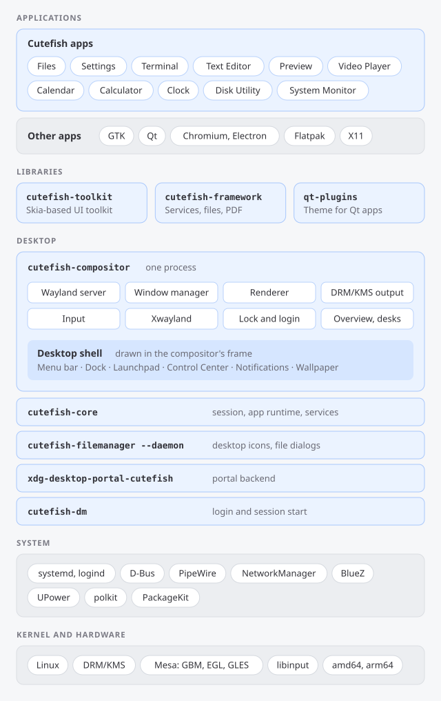
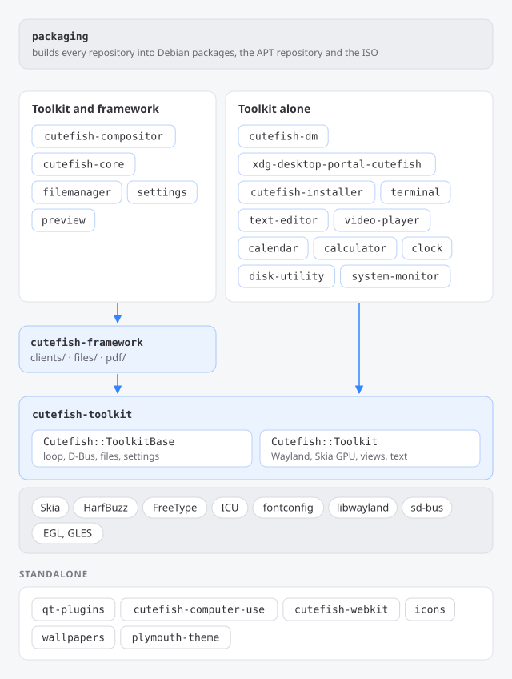
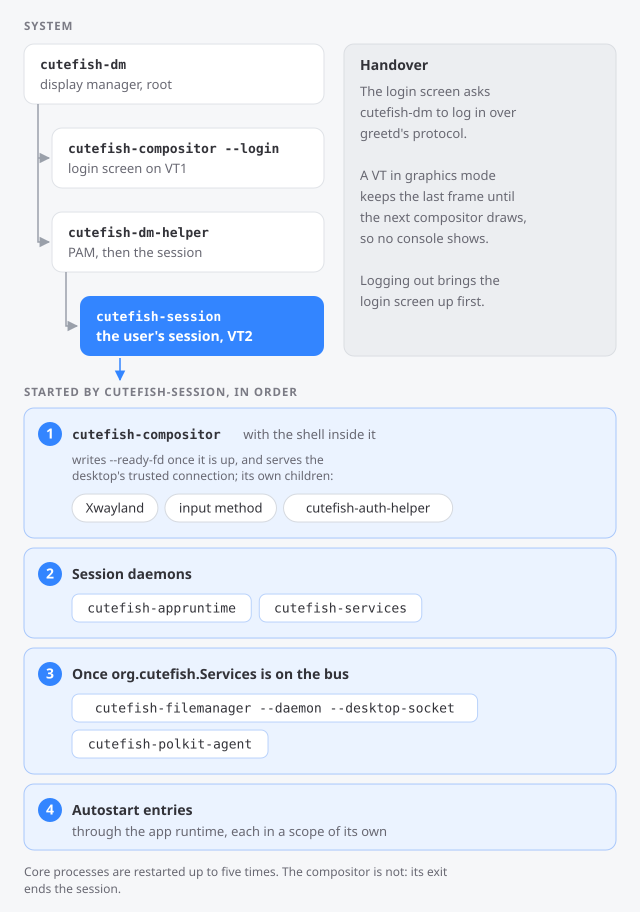
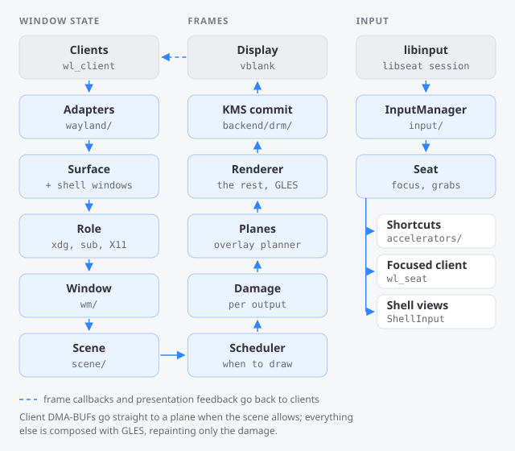
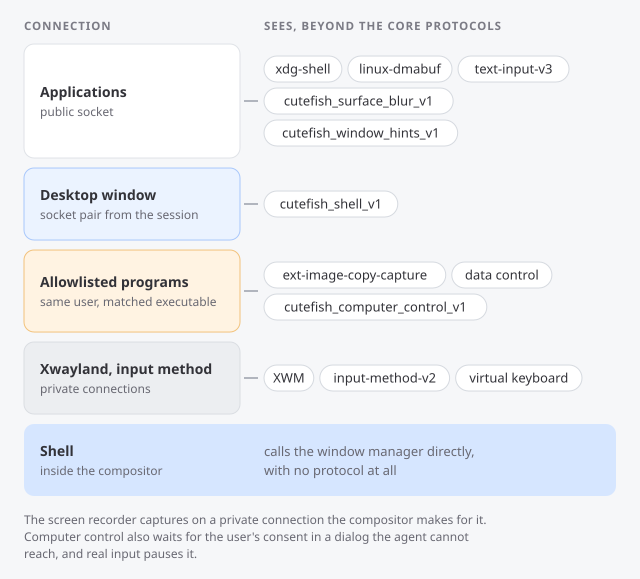
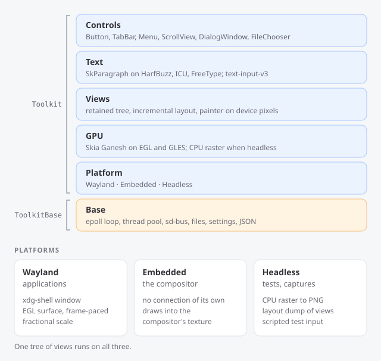
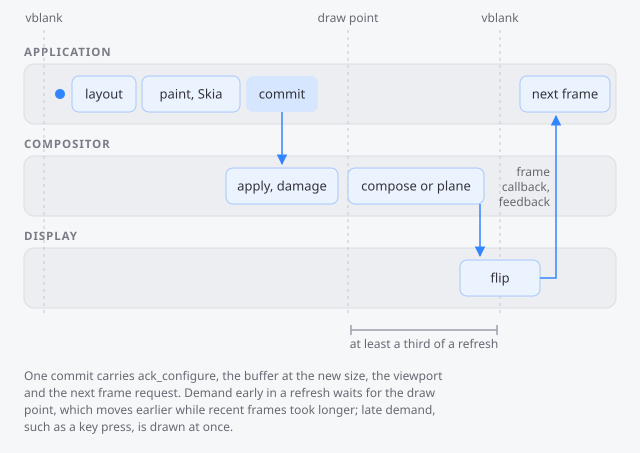

# Architecture

How the Cutefish desktop is put together: the processes that run, the
libraries they share, the Wayland protocols between them, and the path a
frame and an input event take through the system. It is written for people
who want to read or change the code, and assumes some familiarity with Linux
and Wayland.



## Principles

A few decisions shape everything below:

- **One compositor.** Cutefish runs only on its own Wayland compositor,
  `cutefish-compositor`. Window management, rendering, input, the lock and
  login screens and the whole desktop shell live in that one process. There
  is no X11 session and no support for other compositors.
- **One toolkit.** Every Cutefish program, from the compositor's shell to the
  calculator, draws with `cutefish-toolkit`, a C++20 toolkit on Skia. It is
  written for this one compositor and this one design, which is what keeps it
  small.
- **Own protocols, version 1.** What standard Wayland protocols cannot say,
  private `cutefish_*` protocols say. Their XML lives in the compositor, the
  toolkit carries an identical copy of the ones it uses, and they are
  extended within version 1.
- **No desktop frameworks underneath.** Cutefish uses no KDE Frameworks,
  Plasma, KWin, GNOME or GIO components. It talks to the standard system
  services (systemd, D-Bus, NetworkManager, BlueZ, UPower, PipeWire, polkit,
  PackageKit) directly, through its own clients.
- **Third-party applications fit in.** GTK, Qt, Chromium and Electron
  applications run as ordinary Wayland clients, X11 applications through
  Xwayland, and sandboxed applications through `xdg-desktop-portal`.

Much of the compositor and the toolkit follows the structure of Chromium's
Exo, Ash, Ozone, Viz and `views` code, reimplemented for this desktop.

## Repositories

Each component is a repository under
[github.com/cutefishos](https://github.com/cutefishos). Everything installs
into `/usr`; [Building Cutefish from Source](building.md) builds the
desktop's repositories in order.



| Repository | What it is |
|---|---|
| `cutefish-toolkit` | The UI toolkit, and the base library that daemons use on its own |
| `cutefish-framework` | Clients of system services, the file library, PDF documents |
| `cutefish-compositor` | Wayland compositor, window manager, renderer, shell, lock and login screen |
| `cutefish-core` | The session, the app runtime, the services daemon, polkit agent, privacy service, screen recorder |
| `cutefish-dm` | Display manager |
| `filemanager` | File manager; its daemon also draws the desktop icons and the file dialogs |
| `xdg-desktop-portal-cutefish` | Portal backend: settings, file chooser, idle inhibition, screen cast |
| `qt-plugins` | Platform theme and image formats for third-party Qt 6 applications |
| `cutefish-computer-use` | MCP server that lets agents see and use the desktop, with the user's consent |
| `cutefish-webkit` | Web engine: a WebKit port that renders with Skia into DMA-BUFs |
| `cutefish-installer` | Installs the live system onto a disk |
| Applications | `settings`, `terminal`, `text-editor`, `preview`, `video-player`, `calendar`, `calculator`, `clock`, `disk-utility`, `system-monitor` |
| Data | `icons`, `wallpapers`, `plymouth-theme` |
| `packaging` | Debian packaging, the APT repository workflow and the live ISO |
| `cutefish` | Project overview and this documentation |

The repositories carry no packaging of their own; it all lives in
`packaging`.

## From power on to the desktop



### Login

`cutefish-dm` is a root daemon on the system bus
(`org.cutefish.DisplayManager`). It starts the login screen, which is the
compositor itself started as `cutefish-compositor --login` on VT1, and talks
to it over greetd's protocol. When the user logs in, the daemon starts
`cutefish-dm-helper`, which runs PAM and then the session the user picked: a
Cutefish session, or any other `wayland-sessions` entry.

The session runs on VT2. Only one VT at a time owns the display, so a
handover is a VT switch. Before it, the display manager puts the target VT in
graphics mode: the screen keeps the last frame instead of showing the text
console, until the next compositor takes the display and commits its first
frame. Before logging out, the session asks the display manager to switch back
to the login screen, so the login screen is up before the session ends.

The login screen shows the chosen account's wallpaper. The user's home may be
closed or encrypted, so the display manager keeps a world-readable copy of it
under `/var/lib/cutefish-dm/`.

### The session

`cutefish-session` starts the desktop in a fixed order:

1. **The compositor.** It gets the Wayland socket name, a pipe it writes to
   once it is ready (`--ready-fd`), and a control socket for the desktop's
   trusted connection (`--shell-control-socket`). The shell starts inside it.
2. **The session daemons**, once the compositor is ready:
   `cutefish-appruntime` first, because it owns every application start, then
   `cutefish-services`.
3. **The desktop**, once `org.cutefish.Services` is on the bus:
   `cutefish-filemanager --daemon --desktop-socket <fd>`, which draws the
   desktop icons, and `cutefish-polkit-agent`, which asks for administrator
   passwords.
4. **Autostart entries**, through the app runtime.

The session restarts the processes it started when they exit, one second
after the first exit and two seconds more for each restart after it, at most
five times; a process that stayed up for 30 seconds starts a fresh count. The
compositor is the exception: when it exits, the session ends, since there is
no display left to run on.

### Applications

Nothing in the desktop forks applications itself. The dock, the launchpad,
the file manager, notifications and agents all ask `cutefish-appruntime`
(`org.cutefish.AppRuntime`), which starts each application as its own child
in a systemd scope of its own. The runtime therefore knows which application
every process belongs to, so it can quit it and reopen it after a crash.

## cutefish-compositor

The compositor is one process: Wayland server, window manager, renderer,
DRM/KMS output, input, server-side decoration, the lock and login screen, the
application switcher, the overview and desks, rootless Xwayland, and the
desktop shell with the wallpaper. Every source directory builds a static
library (`cutefish-wayland`, `cutefish-wm`, `cutefish-render`, …) linked into
the executable, so each test links only what it exercises.



### Window state

State moves through a fixed chain of layers:

```text
wl_resource  ->  Surface  ->  role (xdg toplevel, subsurface, X11)  ->  wm::Window  ->  scene::Node
 wayland/        compositor/       wm/, xwayland/                         wm/            scene/
```

- **Protocol adapters** (`wayland/`, one per protocol) translate requests and
  hold no window state. The window manager never sees a `wl_resource`.
- **Surfaces** (`compositor/`) keep pending, cached and current state, so a
  subsurface in synchronized mode applies together with its parent.
- **Roles** turn a surface into an xdg toplevel or popup, a subsurface, or an
  X11 window from the built-in window manager for Xwayland.
- **Windows** (`wm/`) are where activation, stacking, placement, modality,
  snapping, maximizing, desks and the overview happen, the same for Wayland
  and X11 windows.
- **The scene** (`scene/`) is one logical tree for all outputs; each output
  renders its own viewport of it.

Shell windows enter the same chain without a client: they are surfaces whose
contents the shell commits from inside the process.

### Frames

Rendering is EGL and OpenGL ES on GBM, with one render target per output.

- **Damage.** Each output repaints only what changed since its buffer was last
  shown, and each buffer is repaired with the damage it missed.
- **Planes.** Before composing, each frame decides which client DMA-BUFs go
  straight onto KMS planes, where the scene and the hardware allow it; only
  the rest is composed with GLES, so a full-screen video or game is not
  composed at all. Imports use explicit synchronization where the client offers it, and
  the cursor is a hardware cursor plane.
- **Effects.** Background blur follows the backdrop-filter model: the scene
  behind a surface is sampled and blurred, clipped to a rounded shape, and the
  client's translucent buffer is drawn over it, so text and icons stay sharp.
  The client owns the tint and the compositor owns the blur; the glass of the
  dock and of popup menus is drawn the same way. The renderer also draws
  window shadows and animates windows opening, closing, minimizing and
  changing size, without ever sending clients intermediate sizes.
- **Scheduling.** An output scheduler decides when each frame begins, on the
  display's own vblank, taken from each flip's timestamp. Demand that arrives
  early in a refresh waits for a draw point at least a third of a refresh
  before the next vblank, and earlier while recent frames took longer to
  draw, so what clients commit in the meantime makes the same frame; later
  demand, such as a key press, is drawn at once. Up to two frames may be in
  flight, so a frame that overruns its refresh costs that one refresh and not
  the next.

Outputs have fractional scales. The compositor always renders at the native
resolution; clients learn their scale through `wp_fractional_scale_v1` and
present buffers of exactly the output's device size through
`wp_viewporter`, which are mapped one to one.

### Input

`libinput` on a `libseat` session feeds the `InputManager`, and one `Seat`
with its pointer, keyboard and touch objects decides where every event goes:
to a shortcut, to the focused client, or to the shell. Keymaps come from
`xkbcommon`. The seat implements pointer constraints and relative motion,
touchpad gestures, touchscreens, drag and drop,
the clipboard and primary selection, and text input, which it relays to the
input method the user picked in Settings. Three-finger swipes switch desks and
open the overview.

### Lock and login screen

The lock screen and the login screen are drawn by the compositor itself;
external lockers are not supported. A password is checked by
`cutefish-auth-helper`, a separate PAM process started for each attempt, so
PAM modules never run inside the compositor.

### Xwayland

X11 applications run in a rootless Xwayland that starts on demand when the
first X11 client connects. The compositor's own window manager for X11
integrates them into the same windows, scene, decorations, animations and
task list as Wayland windows, and bridges the clipboard and drag and drop
between the two.

### Services on D-Bus

The compositor owns `org.cutefish.DisplayConfig` (interface
`org.cutefish.DisplayConfig1`: outputs, arrangement, night light),
`org.cutefish.Mouse1`, `Touchpad1`, `Touchscreen1`, `Keyboard1`,
`InputMethod1`, `Shortcuts1`, `HotCorners1`, `Applications1` and
`ComputerControl1`, and `org.freedesktop.ScreenSaver`, and follows logind for
sleep and session state. Settings changes the compositor's preferences only through these
interfaces.

## The shell inside the compositor

The menu bar with the application menus, the dock, the launchpad, Control
Center and its status panels, notifications, the on-screen display, the
clipboard picker, the screenshot interface, password prompts for networks and
Bluetooth, not-responding sheets and the wallpaper are all part of the
compositor, in `src/shell/`. There is no shell process.

This costs something: a crash in the shell ends the session. In return the
shell has no IPC round trips, it animates on the exact frame the compositor
draws, it calls the window manager directly instead of through a
window-management protocol, and it uses less memory than a separate process
would.

How it works:

- Each shell window is a toolkit `EmbeddedWindow` whose frames become the
  contents of a client-less compositor surface. Stacking, the work area,
  focus, desks, the overview and dock auto-hide treat it like any window of
  its role.
- At the start of each output frame, every shell window that asked for a
  frame is rendered by Skia straight into a texture of the compositor's own
  EGL context, in one batch, then committed with its damage like a client's
  buffer.
- Input reaches the shell as one more client of the seat, so grabs, popups,
  the cursor and the lock screen's gate apply to it as to anyone.
- Menus and popups are the toolkit's; the compositor places them against the
  work area as it places xdg popups.

Each part of the shell is a component with its own static library, and each
owns its D-Bus name: `org.cutefish.MenuBar`, `Dock`, `Launchpad`, `Osd`,
`Screenshot`, `Notification`, `ClipboardHistory` and `SecretAgent`, plus the
standard `org.freedesktop.Notifications`, the status notifier watcher and the
application menu registrar that third-party applications use. Nothing in the
shell blocks the compositor's thread: D-Bus calls are asynchronous, files are
read and written on one serial file thread, and pictures decode on the
toolkit's thread pool.

The desktop icons are not the shell's. The file manager's daemon draws them
in a window with the desktop role, below every application and over the
wallpaper the compositor draws.

## Connections and privilege

Privilege belongs to a Wayland connection, never to a user id alone: every
client of a session runs as the same user, so the user id by itself says
nothing.



- **Applications** connect to the public socket and see the public protocols:
  the core and xdg protocols, viewporter, fractional scale, presentation time,
  linux-dmabuf with explicit sync, text input, cursor shape, xdg-activation
  and xdg-foreign, pointer constraints and gestures, idle inhibition, and the
  Cutefish protocols meant for every application, such as
  `cutefish_surface_blur_v1` (blur and glass behind a window) and
  `cutefish_window_hints_v1`.
- **The desktop window** gets a trusted connection. For every start of the
  file manager's daemon, the session makes a socket pair, passes one end to
  the compositor over its control socket and the other to the daemon. Only on
  that connection is `cutefish_shell_v1` visible, which gives a surface the
  desktop role and sends it the work area.
- **Allowlisted programs** are recognized by the user id and the executable
  the kernel reports for the connecting process (`/proc/<pid>/exe`). Screen
  capture (`ext-image-copy-capture`), clipboard data control and computer
  control are offered to them and to no other public client.
- **Private connections** are ones the compositor makes itself: for
  Xwayland, for the input method, and for the screen recorder, which
  captures on a connection the shell hands it.

The `cutefish_*` protocols are extended inside version 1, in the
compositor's `protocols/` and in the identical copies the toolkit carries of
the ones it uses.

## cutefish-toolkit

The toolkit is two shared libraries:

- `Cutefish::ToolkitBase` (`libcutefish-toolkit-base`, namespace
  `cutefish::base`): an epoll event loop with timers and callbacks, a thread
  pool whose results come back through the loop, signals, D-Bus on sd-bus,
  XDG paths, atomic file writes and file watching, INI settings, JSON,
  processes, desktop entries and MIME types, locale data from CLDR and ICU
  collation. It has no Skia, Wayland or EGL in it; daemons such as the
  display manager and the portal link only this.
- `Cutefish::Toolkit` (`libcutefish-toolkit`, namespace `cutefish::ui`): the
  Wayland platform, GPU rendering, views, text and controls. Skia is fetched
  at a pinned revision, built as part of the toolkit and linked statically
  with hidden symbols; only `cutefish::*` symbols are exported.



### Layers

1. **Base**: the library above.
2. **Platform**: `Wayland` for applications, `Embedded` for the compositor,
   `Headless` for tests and captures. One view tree runs on all three.
3. **GPU**: Skia's Ganesh backend on EGL and GLES; Skia's CPU raster backend
   when headless.
4. **Views**: a retained tree in logical units. Views keep their state in
   plain members and ask for work with `requestLayout()` and `requestPaint()`.
   Layout is incremental: only views that asked, their ancestors, and views
   whose size changed lay out again.
5. **Text**: SkParagraph on HarfBuzz, ICU, FreeType and fontconfig, with
   editing, bidirectional text and input methods through text-input-v3.
6. **Controls**: buttons, switches, sliders, segmented controls, tab bars, text
   fields, scroll views with shared touchpad physics, list views, menus,
   dialogs, the window header with its buttons, and the file chooser, all
   following the [Design Rules](design-rules.md).

Views can carry a name (`View::name()`), which layout dumps and tests use to
find them; it is not shown.

UI is plain C++. There is no markup language, script engine or binding
system; colors are named by purpose and mixed from recipes per theme, so light
and dark mode come from one table.

### Pixels

- Layout is in logical units and the painter maps to device pixels.
  Rectangles put each edge on its own device pixel; rounded shapes and icons
  snap their first edge and keep their size; hairlines are one device pixel.
- At a whole scale, text follows fontconfig's hinting. At a fractional scale,
  glyphs are drawn unhinted at quarter-pixel positions with each baseline on a
  device row.
- The buffer is `round(logical size × scale)`, and the viewport destination is
  the logical size.

### Frames

Rendering runs on the UI thread, paced by `wl_surface.frame`, with a swap
interval of 0 so EGL never blocks. A configure is laid out and rendered before
control returns to the loop, and `ack_configure`, the buffer at the new size,
the viewport and the next frame request go out in one commit. Animations step
on the window's frame time.



### Start-up

An application's first frame does not wait for work that can run alongside
it: the EGL driver loads and Skia's GL context is made on a thread, the fonts
load on a thread of their own, the keymap compiles on the thread pool, the
appearance settings arrive with the session bus connection, and Skia's compiled GL programs are kept on disk between runs.

### Inside the compositor

On the embedded platform there is no Wayland connection, no EGL setup and no
D-Bus connection of the toolkit's own. The compositor's loop drives the
toolkit's, feeds it input from the seat, and asks each `EmbeddedWindow` to
render at the output's frame time. Skia draws into a texture of the
compositor's EGL context under a fixed contract for the GL state it leaves
behind; without a usable GL context the window renders on the CPU and only
its damage is uploaded.

## Session services: cutefish-core

| Program | Bus | What it does |
|---|---|---|
| `cutefish-session` | session | Starts and restarts the desktop's processes and autostart entries; log out, restart, power off and suspend (`org.cutefish.Session`) |
| `cutefish-appruntime` | session | Starts every application in a scope of its own, quits and reopens them (`org.cutefish.AppRuntime`) |
| `cutefish-services` | session | Appearance and fonts, language and region, battery, brightness, night light and dark-mode schedules, power and sleep policy, permission prompts, software updates, crash dialogs, the network proxy, and a clipboard that outlives the application that copied |
| `cutefish-polkit-agent` | session | Administrator password dialogs |
| `cutefish-privacy` | system | Camera and microphone switches that hold for every user and process |
| `cutefish-screenrecorder` | | Screen recording, encoded on the GPU through VA-API, or with x264 without it |

`cutefish-services` publishes its parts under `org.cutefish.Services`
(`Appearance`, `Battery`, `Brightness`, `Language`, `NightLight`,
`Permissions`, `Power`, `SoftwareUpdate`). It writes the session's fontconfig
file and mirrors the font settings into GTK's settings, so third-party
applications render text the way Cutefish does.

## System integration

### cutefish-framework

The framework builds on `ToolkitBase` and installs three CMake packages:

- `CutefishClients`: one small library per system service, asked for by name:
  accounts, appearance, audio (native PipeWire with WirePlumber), BlueZ,
  display, fingerprint, NetworkManager, PackageKit, power profiles, time and
  date, UPower.
- `CutefishFiles`: directory listing and models, MIME types, file operations
  as tasks, trash, volumes and thumbnails.
- `CutefishPdf`: PDF pages, text, search, links and outlines, read with
  PDFium.

The compositor's shell, Settings, cutefish-core, the file manager and Preview
use these instead of each talking to the services in its own way.

### Third-party applications

- **Qt** applications load the `cutefish` platform theme from `qt-plugins`:
  they follow dark mode, the system fonts, icons and cursors, open the
  Cutefish file chooser, and scroll with the same touchpad physics as
  Cutefish's own applications.
- **Sandboxed and browser** applications reach the desktop through
  `xdg-desktop-portal-cutefish`: the color scheme setting, the file chooser
  (whose dialog runs in the file manager's daemon, with its folders and
  favorites), idle inhibition and screen casting through PipeWire.
- **Chromium-based** applications started through the app runtime get a
  command-line switch that makes them follow fontconfig's hinting.
- **Notifications** from any toolkit reach the shell's
  `org.freedesktop.Notifications`.

### The file manager's daemon

One resident process serves every file manager window and dialog of the
session: the desktop icons, folders opened from the dock or the desktop,
`org.freedesktop.FileManager1` requests, space-bar file previews, and the
portal's file dialogs. Opening a window costs no process start, and the file
chooser shows folders exactly as the file manager does.

## Applications

Every built-in application is a toolkit Wayland client that starts through
the app runtime and keeps its settings in `~/.config/cutefish/`. Some lean on
a library for the work at their core:

- **Terminal** keeps its terminal state, parsing, scrollback, selection and
  input encoding in [libghostty-vt](https://github.com/ghostty-org/ghostty);
  the pty, the drawing and the windows are its own.
- **Video Player** draws libmpv into a toolkit subsurface with its own GL
  context, synchronized with the window only while it resizes.
- **Preview** shows images through the toolkit's decoders and PDFs through
  `CutefishPdf`.
- **Settings** is a client of nearly every service: the compositor's
  interfaces, `cutefish-services` and the framework's clients.

`cutefish-webkit` is the desktop's web engine: a WebKit port based on WPE
WebKit that renders with Skia into DMA-BUF buffers and hands them to the
embedding application through a C API, with web processes in WebKit's
bubblewrap sandbox.

## Agents: computer use

`cutefish-computer-use` is an MCP server, written in Rust, that lets agent
applications such as Claude Code and Codex see the screen and use the pointer
and keyboard. It is the only client of the compositor's
`cutefish_computer_control_v1`, and captures through
`ext-image-copy-capture`.

The compositor enforces the boundary, not the server:

- Control starts only after the user agrees in a dialog that the compositor
  asked for and the agent cannot click, type into or fake.
- While an agent is in control, the menu bar shows a Stop button.
- Real input always wins: touching the pointer or keyboard pauses the agent.

## Configuration

User preferences live flat in `~/.config/cutefish/`, in files named after the
process that writes them, without the `cutefish-` prefix; most processes
write one. Each file has one
writer; any other process changes a value through the writer's D-Bus
interface.

| File | Written by | Holds |
|---|---|---|
| `compositor.conf` | compositor | keyboard, mouse, touchpad, touchscreen, input method, shortcuts, desks, hot corners |
| `display.json` | compositor | output arrangements |
| `shell.conf` | compositor's shell | dock, launchpad, notifications, screenshots, menu bar |
| `services.conf` | `cutefish-services` | appearance, language, region, power, battery, night light, software updates |
| `filemanager.conf` | file manager | folder views, places, the desktop's icons |
| `<application>.conf` | each application | its own settings and window size |

Standard files stay standard: default applications are in
`~/.config/mimeapps.list` and the default terminal in
`~/.config/xdg-terminals.list`.

## Translations

User-visible text is translated with gettext catalogs in each repository's
`po/` directory; [Adding a Language](translating.md) explains how to add or
correct one.

## Building and shipping

Every repository builds with CMake (the computer-use server with Cargo), and
the toolkit builds its pinned Skia with GN and Ninja.

Packages are built by public GitHub Actions workflows in the `packaging`
repository, on fresh Debian 13 machines, for `amd64` and `arm64`. They are
published to the APT repository at
[download.cutefish.org](https://download.cutefish.org), with signed build
provenance for every file. The live ISO is built with live-build from the same
repository, and `cutefish-installer` installs it: a toolkit application with
a D-Bus activated root service, which runs only from a live medium, that
erases the chosen disk, copies the image onto it, creates the first user and
installs the boot loader.

## Testing

Each repository has GoogleTest suites, and the architecture is shaped to make
them meaningful:

- **Headless rendering.** Any view tree renders to PNG through Skia's CPU
  backend, with the same output on every machine.
- **Layout dumps.** Every view's logical and device rectangle is listed, so
  alignment and centering are read off rather than measured from pixels.
- **Scripted input.** The toolkit's test driver works a headless window as its
  user would, finding views by name and by the text they show, and feeding
  input through the toolkit's test input instead of screen coordinates.
- **A headless compositor.** `cutefish-compositor --no-drm` runs with virtual
  outputs and a 60 Hz clock; window-manager, protocol and shell tests run
  against it, and pixel tests run on a software GL driver.
- **Fake services.** Session and service tests run on a private D-Bus with
  fake logind, UPower and other services.
